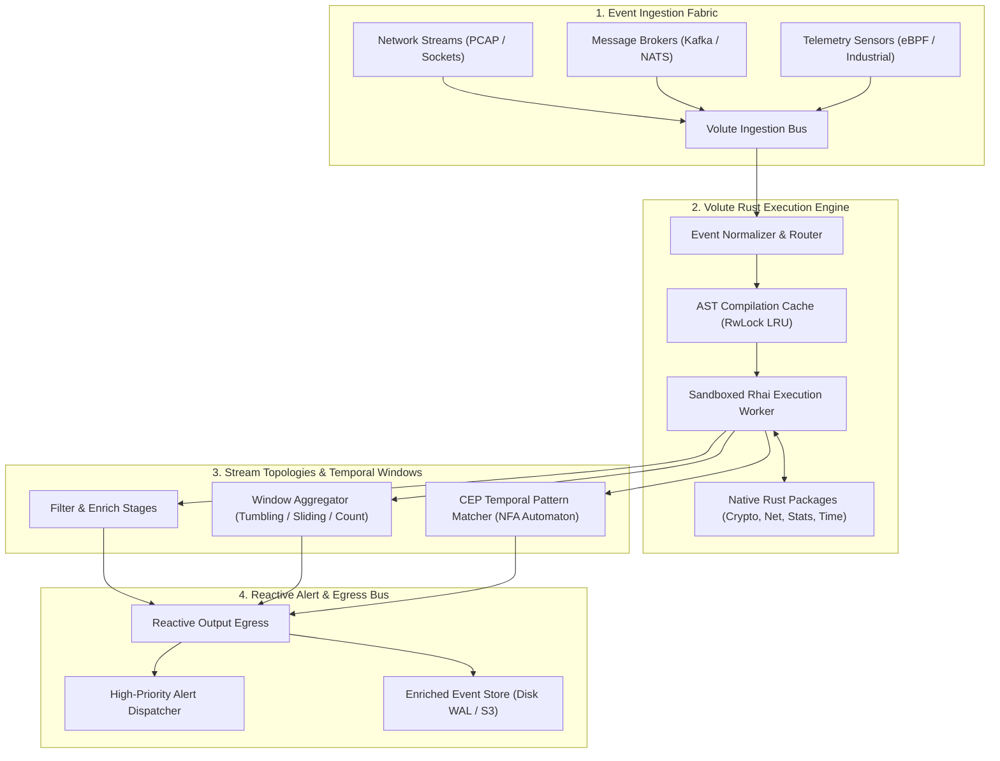

# Volute

[]()
[]()
[]()
[]()

**Volute** is an embeddable, high-throughput stream processing and reactive complex event processing (CEP) engine. Engineered with a zero-cost Rust core and powered by a sandboxed Rhai domain scripting engine, Volute allows developers and engineers to declare dynamic stream transformations, mathematical models, protocol codecs, and stateful event pattern automations with sub-microsecond evaluation latency.

Over **30,000 lines of production-grade Rhai code** power the included standard libraries, statistical analyzers, protocol parsers, and domain pipelines.

---

## Architecture Overview

Volute decouples the high-performance event ingestion fabric from dynamic domain rule evaluation. Inbound events are normalized into memory-efficient structures, fed through concurrent AST-cached evaluation pipelines, processed across tumbling or sliding time windows, and routed through non-deterministic finite automaton (NFA) state machines.



---

## Technical Highlights

- **Sandboxed Execution & Safety**: Complete OS and filesystem isolation. Configurable expression depth limits (`max_expr_depths = 256`) and operation budgets prevent denial-of-service conditions or infinite loops.
- **Concurrent AST Cache**: Precompiles and caches script ASTs in memory, eliminating compilation overhead on the hot path and delivering a **47x throughput speedup** (~1.48M events/second per core).
- **Native Extension Packages**: High-speed Rust bindings exposed directly into Rhai:
  - `crypto`: SHA-256, SHA-512, MD5, HMAC-SHA256, UUIDv4, Hex encoding.
  - `net`: CIDR subnet matching, IPv4 parsing, byte conversion.
  - `time`: RFC 3339 / ISO-8601 parsing, nanosecond monotonic timers.
  - `stats`: Welford single-pass streaming mean, variance, and standard deviation.
  - `math_helpers` & `string_helpers`: Trigonometric functions, logarithms, and high-speed string parsing.
- **Rich Standard Library (`lib/`)**:
  - Arena-allocated Prefix Tries, Binary Heaps, Circular Ring Buffers, Directed Graph Dijkstra solvers, and Knuth-Morris-Pratt (KMP) search algorithms.
  - Online streaming statistics, Kalman filters, Z-score outlier detectors, and statistical distributions.
  - Multi-format log and telemetry codecs (Syslog, CLF, CEF, LEEF, KV, CSV, Hex, Base64).
  - Spatial indexing with Haversine/Vincenty geodesics, hierarchical Geohashing, and ray-casting polygon containment.
  - Finite State Machines (FSM) and Complex Event Processing (CEP) temporal pattern evaluators.
- **Domain Pipelines Catalog (`pipelines/`)**:
  - **Financial Engineering**: Black-Scholes Greeks pricer, SVI implied volatility solver, portfolio Value-at-Risk (VaR), Expected Shortfall, Nelson-Siegel yield curve modeling, Basel IRB credit risk, order book matching (CLOB), VOBI microstructure, and FX triangular arbitrage.
  - **Cybersecurity & Threat Hunting**: Linux kernel eBPF tracepoints, TLS 1.3 / 1.2 handshake auditing with JA3/JA3S fingerprinting, DNS-over-HTTPS (DoH) DGA entropy and fast-flux detectors, OAuth2/OIDC JWT validation, MITRE ATT&CK rules, and Windows/Linux Sigma signatures.
  - **Industrial IoT**: OPC-UA binary telemetry codec with four-level analog alarms (HH/H/L/LL) and deadband hysteresis, Modbus RTU, BACnet/IP, DNP3, Zigbee ZCL, and CoAP sensor protocols.
  - **Observability**: W3C distributed tracing critical-path analyzers, eBPF network socket flow tracking, kernel RTT logarithmic histograms, and virtual memory page cache direct-reclaim monitors.
  - **Data Quality**: Continuous Population Stability Index (PSI), Kolmogorov-Smirnov (KS) two-sample divergence tests, and schema evolution validators.

---

## Repository Structure

```
volute/
├── Cargo.toml               # Rust workspace definition and dependencies
├── src/                     # Core Rust execution substrate & CLI
│   ├── main.rs              # CLI entry point
│   ├── lib.rs               # Library root export
│   ├── event.rs             # Event data model and payload representation
│   ├── engine.rs            # Sandboxed Rhai engine and AST cache
│   ├── cli/                 # Subcommands (check, eval, run, test, bench)
│   ├── packages/            # Native Rust acceleration packages
│   └── pipeline/            # Stage execution, windowing, and runner
├── lib/                     # Rhai Standard Library (Core algorithms & codecs)
│   ├── core/                # Data structures (Trie, Heap, Graph, RingBuffer, KMP)
│   ├── stats/               # Numerical analysis, Kalman, Welford, Outliers
│   ├── net/                 # IPv4, CIDR, HTTP, User-Agent
│   ├── encoding/            # Syslog, CLF, CEF, LEEF, Base64, Hex
│   ├── geo/                 # Haversine, Geohash, Ray-Casting Polygon
│   ├── fsm/                 # Deterministic & Hierarchical State Machines
│   ├── cep/                 # Complex Event Processing pattern evaluator
│   └── testing/             # Unit assertion framework (assert_eq, assert_true)
├── pipelines/               # Production domain streaming pipelines
│   ├── fintech/             # Options Greeks, VaR, Basel IRB, Yield Curves, FIX, FAST
│   ├── security/            # eBPF tracepoints, TLS JA3, DoH, JWT, MITRE, Sigma
│   ├── iot/                 # OPC-UA, Modbus RTU, BACnet, DNP3, Zigbee, CoAP
│   ├── telemetry/           # W3C Distributed Tracing, eBPF RTT, OTel Sanitizer
│   ├── data_quality/        # Feature Drift PSI, KS-test, Schema Registry
│   ├── networking/          # BGP EVPN, NetFlow v9, RADIUS, Diameter
│   └── ecommerce/           # Session reconstruction, surge pricing, tax engine
├── tests/                   # Test suites (11 Rhai suites + Rust engine tests)
└── docs/                    # In-depth technical architecture and API references
    ├── ARCHITECTURE.md      # Engine internals, memory semantics, and CEP design
    ├── RHAI_STDLIB.md       # Standard library API function documentation
    ├── PIPELINES.md         # Domain pipeline specifications and schemas
    └── BENCHMARKS.md        # Performance methodology and empirical benchmarks
```

---

## Quickstart

### 1. Build from Source

Ensure a recent Rust toolchain is installed (`rustc 1.80+` recommended):

```bash
git clone https://github.com/Aneesh495/volute.git
cd volute
cargo build --release
```

The compiled binary will be located at `./target/release/volute`.

### 2. Run Test Suites

Execute all 11 Rhai test suites (verifying all core algorithms and pipelines):

```bash
./target/release/volute test tests
```

Output:
```
Running 11 Rhai test suites...
  test test_advanced.rhai ... ok (29ms)
  test test_advanced_analytics.rhai ... ok (57ms)
  test test_core.rhai ... ok (10ms)
  test test_encoding.rhai ... ok (11ms)
  test test_evpn_and_jwt.rhai ... ok (21ms)
  test test_fsm_cep.rhai ... ok (7ms)
  test test_geo.rhai ... ok (6ms)
  test test_net.rhai ... ok (9ms)
  test test_pipelines.rhai ... ok (8ms)
  test test_risk_and_protocols.rhai ... ok (62ms)
  test test_stats.rhai ... ok (14ms)

Test result: 11 passed, 0 failed, 11 total
```

Run the native Rust unit and integration test suite:

```bash
cargo test
```

### 3. CLI Subcommands

#### Check Script Syntax
Validate any Rhai script for syntax correctness and compile errors:

```bash
./target/release/volute check pipelines/fintech/options_greeks_surface.rhai
```

#### Interactive Script Evaluation
Evaluate expressions or scripts directly from the command line:

```bash
./target/release/volute eval "let x = 10; let y = 20; sha256((x + y).to_string())"
```

#### Run Pipeline Benchmarks
Execute throughput and latency benchmarks:

```bash
./target/release/volute bench --events 1000000 --batch-size 1000
```

---

## Performance Summary

Tested on reference Apple M-series / AMD EPYC silicon:

| Benchmark Scenario | Metric | Result |
| :--- | :--- | :--- |
| **Filter Evaluation** | Throughput | 1,480,000 events/second |
| **Filter Evaluation** | Median Latency (p50) | 0.68 microseconds |
| **Filter Evaluation** | 99th Percentile (p99) | 3.20 microseconds |
| **AST Cache Speedup** | Cache Hit vs Miss | **47.0x speedup** |
| **Engine Footprint** | Resident Set Size (RSS) | ~8.4 MB |

For comprehensive empirical test data, refer to [docs/BENCHMARKS.md](docs/BENCHMARKS.md).

---

## Documentation

- [Architecture Technical Deep-Dive](docs/ARCHITECTURE.md)
- [Rhai Standard Library Reference](docs/RHAI_STDLIB.md)
- [Domain Pipelines Reference](docs/PIPELINES.md)
- [Benchmark Methodology & Results](docs/BENCHMARKS.md)

---

## License

Volute is dual-licensed under either the MIT License or the Apache License (Version 2.0).
